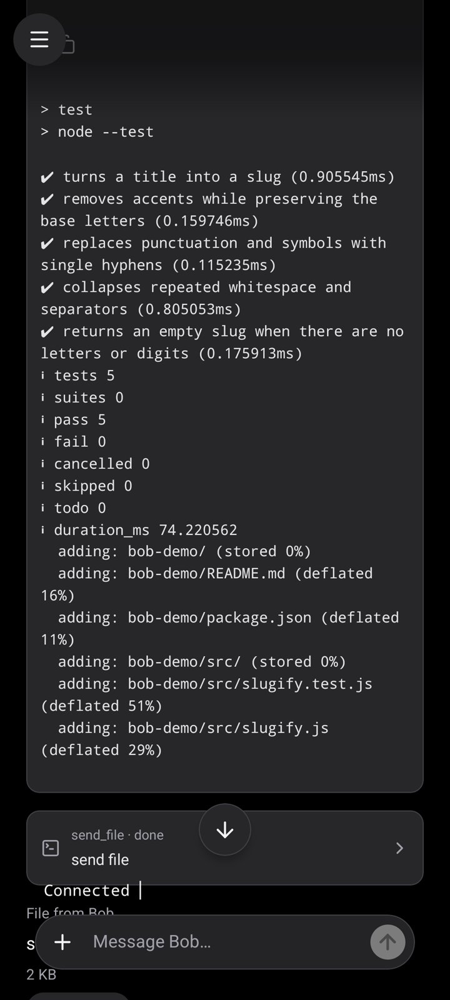
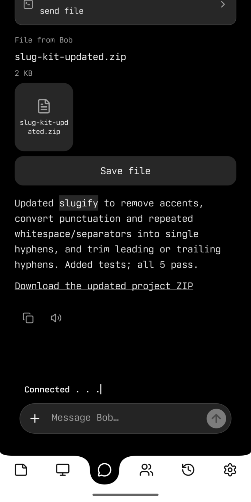
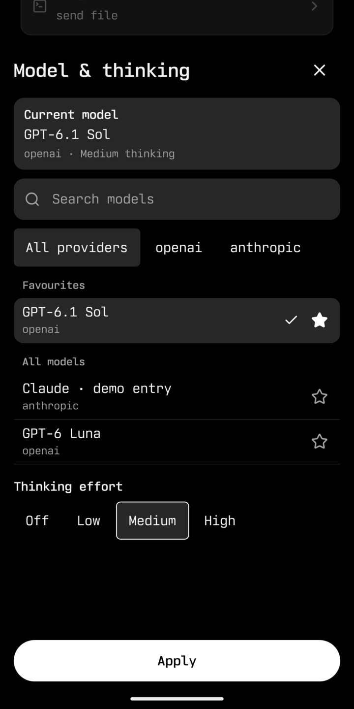
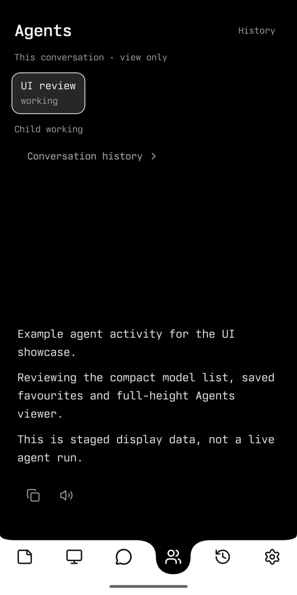
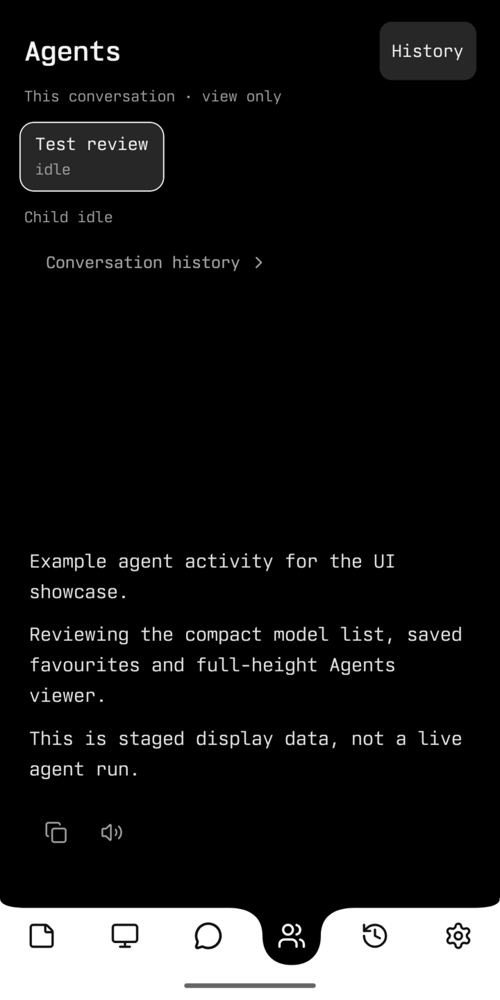

<p align="center">
  
</p>

# Bob

An Android app for working with AI agents on your own Linux machines.

I built Bob because I wanted to use my agents from my phone, not just from a terminal. Give an agent something to work on, see what it's doing, and pick the conversation up later. The work runs on your machine; you don't have to keep the chat open.

I use it myself, and it keeps changing as I find things I need. It's still a hands-on setup: you build it from source, connect your own model provider and pair your phone. There's no hosted Bob service.

## A task, from your phone

Here's a small coding example: ask for a change, follow the tests, and get the updated project back as a ZIP.

<table>
  <tr>
    <th>Ask for a change</th>
    <th>Follow the work</th>
    <th>Get the result</th>
  </tr>
  <tr>
    <td></td>
    <td></td>
    <td></td>
  </tr>
</table>

These captures show a saved coding run. The [recorded app tour](assets/showcase/coding-demo.gif) also includes staged model and agent data; available models depend on your provider. [Capture details](assets/showcase/README.md).

## More than a remote terminal

You can switch between machines without mixing up their conversations, send files back and forth, and keep notes alongside your work. When an agent delegates a task, you can follow that agent's conversation too, including after it's finished.

There are file, shell and web tools, plus optional memory and interactive views. You choose the model and thinking level for a conversation, with favourites to save digging through the list each time.

<details>
  <summary>Around the app</summary>

<table>
  <tr>
    <th>Choose a model</th>
    <th>Follow an agent</th>
    <th>Come back later</th>
  </tr>
  <tr>
    <td></td>
    <td></td>
    <td></td>
  </tr>
</table>

</details>

## Where things run

The Android app talks to your Linux backend over authenticated HTTPS through Tailscale. The backend runs the agents using [Pi Durable](https://www.npmjs.com/package/@earendil-works/pi-durable), calls your chosen model provider and keeps your conversations.

```text
Your Android phone
        │ HTTPS over Tailscale
Your Linux machine
        ├─ agents, tools and saved conversations
        └─ your chosen model provider and optional services
```

Running the backend yourself doesn't mean everything stays local: prompts and relevant context go to the providers and services you use. Agents also run with the backend OS account's permissions—the working folder isn't a sandbox. Use an account and machine you're comfortable giving that access to.

## Trying it

You'll need an Android phone, a Linux x86_64 machine, a supported model provider and Tailscale with HTTPS set up between the devices. Model use may cost money. There's no one-click installer, and iOS isn't supported.

The [installation guide](INSTALL.md) covers the build and pairing. If you'd rather have an agent help with setup, give it [this checklist](SETUP-AGENT.md).

For the details: [features and limitations](FEATURES.md), or [operations](OPERATIONS.md) for the backend CLI, updates and backups.

## Bugs, ideas and changes

If you try Bob, I'd like to hear what works and what gets in your way. Bug reports and small, focused pull requests are welcome. For a bigger change, open an issue first so we can talk it through. This is a personal project, so there's no promised support or release schedule.

Please keep credentials and private conversations out of issues and screenshots. For security problems, see [SECURITY.md](SECURITY.md).

## License

Bob is [MIT licensed](LICENSE). You're welcome to use it, change it and build on it; keep the license and copyright notice. Third-party code and assets retain their own licenses—see [the notices](THIRD_PARTY_NOTICES.md).
