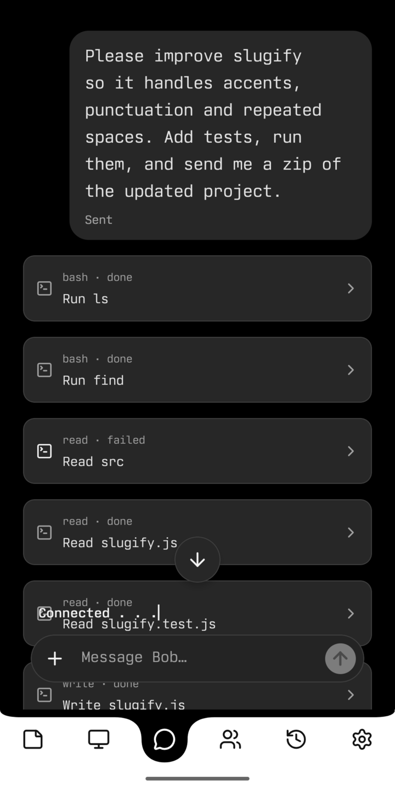
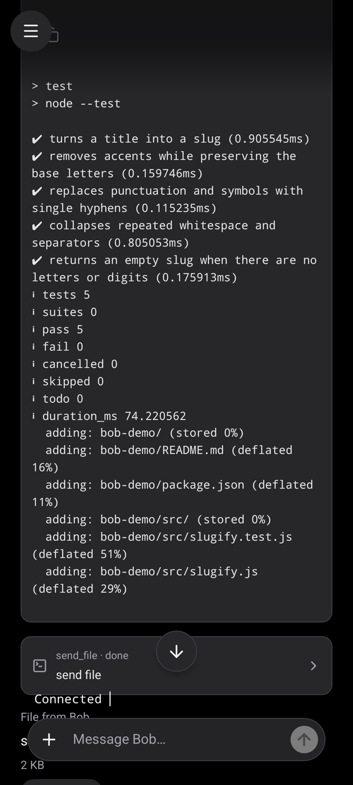
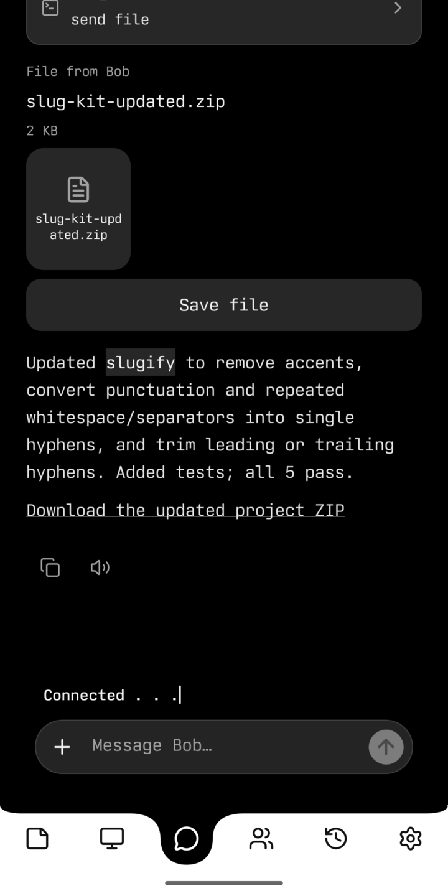
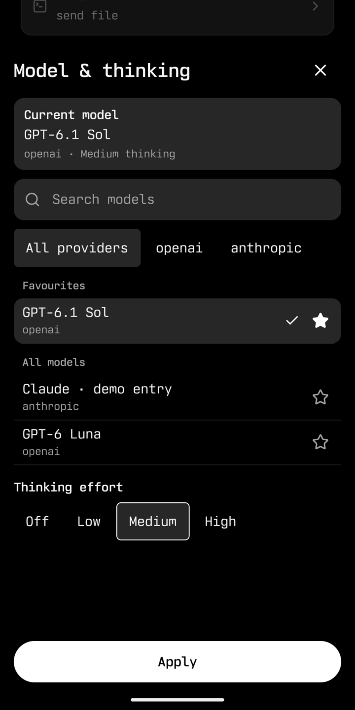
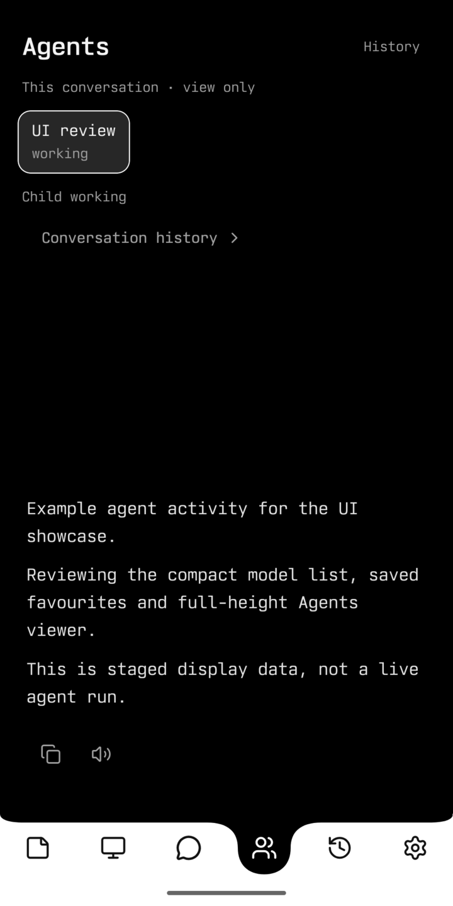
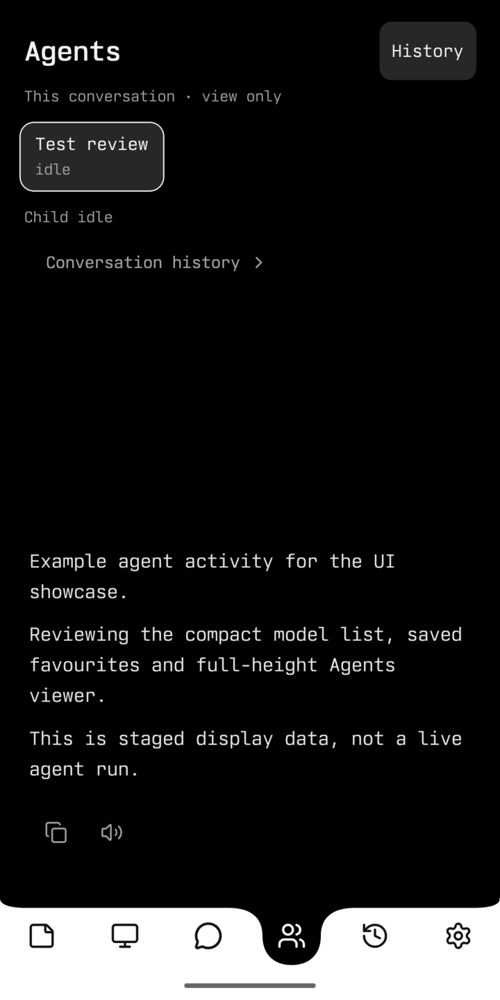

<p align="center">
  
</p>

# Bob

An Android app for working with AI agents on your own Linux machines.

I built Bob because I wanted to use my agents from my phone, not just from a terminal. Give an agent something to work on, see what it's doing, and pick the conversation up later. The work runs on your machine; you don't have to keep the chat open.

I use it myself, and it keeps changing as I find things I need. A guided Linux installer can check your computer, install missing backend prerequisites with your permission, help configure your model and HTTPS connection, and offer a QR code to pair your phone. You still bring your own model account and Android app; there's no hosted Bob service.

## A task, from your phone

Here's a small coding example: ask for a change, follow the tests, and get the updated project back as a ZIP.

<table>
  <tr>
    <th>Ask for a change</th>
    <th>Follow the work</th>
    <th>Get the result</th>
  </tr>
  <tr>
    <td></td>
    <td></td>
    <td></td>
  </tr>
</table>

These captures show a saved coding run. The [recorded app tour](assets/showcase/coding-demo.gif) also includes staged model and agent data; available models depend on your provider. [Capture details](assets/showcase/README.md).

## More than a remote terminal

You can switch between machines without mixing up their conversations, send files back and forth, and keep notes alongside your work. When an agent delegates a task, you can follow that agent's conversation too, including after it's finished.

Optional [Keep connected](FEATURES.md#keep-connected) maintains a small native Android connection while the phone is locked, with a persistent notification and automatic reconnection. The transcript catches up when you reopen Bob; Android and network/battery restrictions still apply. It does not enable locked-phone control.

There are file, shell and web tools, native Android [phone tools](FEATURES.md#phone-tools), plus optional memory and interactive views. The [Android capability map](PHONE-CAPABILITIES.md) distinguishes the implemented controls from the notification, screen-control and other planned layers. You choose the model and thinking level for a conversation, with favourites to save digging through the list each time.

<details>
  <summary>Around the app</summary>

<table>
  <tr>
    <th>Choose a model</th>
    <th>Follow an agent</th>
    <th>Come back later</th>
  </tr>
  <tr>
    <td></td>
    <td></td>
    <td></td>
  </tr>
</table>

</details>

## Where things run

The Android app talks to your Linux backend over authenticated HTTPS through Tailscale. The backend runs the agents using [Pi Durable](https://www.npmjs.com/package/@earendil-works/pi-durable), calls your chosen model provider and keeps your conversations.

```text
Your Android phone
        │ HTTPS over Tailscale
Your Linux machine
        ├─ agents, tools and saved conversations
        └─ your chosen model provider and optional services
```

Running the backend yourself doesn't mean everything stays local: prompts and relevant context go to the providers and services you use. Agents also run with the backend OS account's permissions—the working folder isn't a sandbox. Use an account and machine you're comfortable giving that access to.

## Trying it

You'll need an Android phone, a Linux x86_64 machine with a systemd user session, and your own supported model account. Model use may cost money. iOS isn't supported.

### Guided backend installation

Download and inspect the bootstrap script, then run it as your normal user—not with `sudo`:

```sh
curl --proto '=https' --tlsv1.2 -fL \
  https://raw.githubusercontent.com/followdeKlerk/Bob/main/install.sh \
  -o bob-install.sh
less bob-install.sh
bash bob-install.sh --check
bash bob-install.sh
```

You can also download [install.sh](install.sh) through your browser, or run `bash install.sh` from an existing checkout. Repository access is required; a private checkout needs your own GitHub access. Do not paste access tokens into commands or chat.

The installer:
- Checks existing tools and reuses compatible Node. If needed, it offers a private, checksum-verified Node runtime without replacing your system Node.
- Asks before system package installation, downloads, dependency scripts, configuration and service changes. No unattended “yes to everything” mode.
- Guides Bob-owned provider authentication, Tailscale login, HTTPS certificate provisioning, and a standalone background **user service**.
- Preserves existing credentials and state. Running or supervisor-managed backends are not replaced or restarted; existing checkouts and launchers are not silently upgraded.
- Verifies the intended backend over trusted HTTPS, then asks whether to display a short-lived, single-use pairing QR code.

**The Android app is separate.** Use a trusted signed APK or build your own; ordinary backend installation does not install Java, the Android SDK or the NDK. Tailscale also needs to be installed and signed in on your phone. Account approvals, Android installation approval, and certificate renewal are not silently automated.

After installation, rerun the guided flow with `bob setup --guided` (or `~/.local/bin/bob setup --guided` if that directory is not on your PATH). `bob doctor` remains a read-only local diagnostic. The wizard checks local HTTPS readiness; verify a real model reply and reconnection from the phone before treating setup as complete.

See the [installation guide](INSTALL.md) for supported paths, certificate renewal, existing-installation safeguards and manual setup. The installer configures a standalone service, **not** the optional self-update supervisor. If you'd rather have an agent help, give it [this checklist](SETUP-AGENT.md).

For the details: [features and limitations](FEATURES.md), or [operations](OPERATIONS.md) for the backend CLI, updates and backups.

## Bugs, ideas and changes

If you try Bob, I'd like to hear what works and what gets in your way. Bug reports and small, focused pull requests are welcome. For a bigger change, open an issue first so we can talk it through. This is a personal project, so there's no promised support or release schedule.

Please keep credentials and private conversations out of issues and screenshots. For security problems, see [SECURITY.md](SECURITY.md).

## License

Bob is [MIT licensed](LICENSE). You're welcome to use it, change it and build on it; keep the license and copyright notice. Third-party code and assets retain their own licenses—see [the notices](THIRD_PARTY_NOTICES.md).
