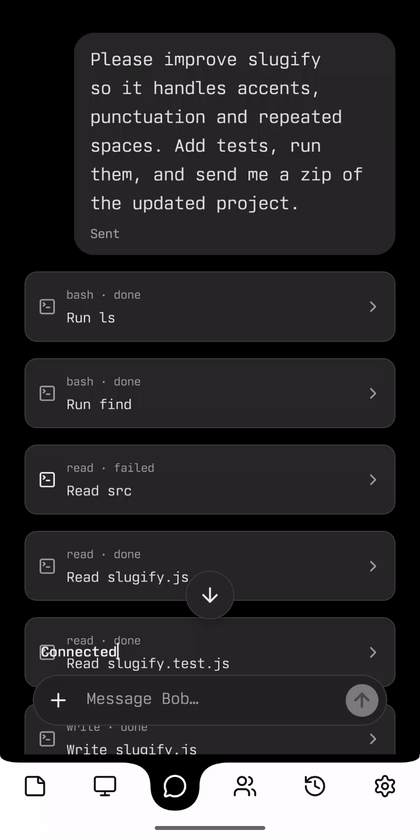

<p align="center">
  
</p>

# Bob

An Android app for working with AI agents on your own Linux machines.

I built Bob because I wanted to use my agents from my phone, not just from a terminal. I use it myself, and it keeps changing as I find things I need. **This is an unfinished personal project, not a polished product.** Expect rough edges and a hands-on setup.

## Around the app

Six bottom tabs keep **Notes · Workstations · Chat · Agents · Sessions · Settings** within reach. The model picker shows the conversation’s current model and thinking level, with locally saved favourites pinned first. Agents has a full-height, view-only transcript: working/stopping agents appear by default, while History reveals inactive ones without deleting them. The edge-to-edge Android surface leaves bottom navigation available rather than requiring a preliminary reveal swipe.

<table>
  <tr>
    <th>Choose a favourite</th>
    <th>Watch an agent</th>
    <th>Return to its history</th>
  </tr>
  <tr>
    <td></td>
    <td></td>
    <td></td>
  </tr>
</table>

<p align="center">
  
</p>


## What it does

- Streams conversations and tool results to your phone. Backend work can continue when you leave the chat.
- Connects to multiple Linux backends, each with its own conversations and configuration.
- Gives agents file, shell and web tools, with optional memory and interactive views.
- Shows delegated agents in a dedicated read-only viewer, separating active work from retained history.
- Lets you choose models and thinking effort, with favourites saved on your phone.
- Lets you exchange files with an agent, keep notes and return to earlier work.

The app uses React Native/TypeScript with native Android integrations. The Node.js backend runs agents through [Pi Durable](https://www.npmjs.com/package/@earendil-works/pi-durable).

## Try it

You need an Android phone, a Linux x86_64 machine, a supported model provider and Tailscale/HTTPS connectivity between them. There is no hosted service or one-click installer. iOS is not supported.

Follow [installation](INSTALL.md), or give your coding agent the [setup instructions](SETUP-AGENT.md). Those instructions ask it to inspect your machine, protect existing data and stop for authentication and installation approvals.

## Command-line management

Bob includes a small backend CLI for setup and administration. Use `bob` when installed, or `node dist/cli.js` from a built checkout. It manages the Linux backend, not the Android app.

```sh
bob --help
bob --state /absolute/path/to/bob-state doctor
bob --state /absolute/path/to/bob-state doctor --check
```

`doctor` prints a JSON report with actionable checks for the Node version, existing state/schema, model and credential presence, working folder, Chromium and runtime ownership. It does not initialize missing state, repair anything, contact providers or restart services. `--check` exits 1 on configuration errors; optional-browser warnings alone do not fail it. This is a local configuration check, **not proof that inference, phone connectivity or optional integrations work**. Reports omit stored credential values, but can contain local paths and model names; review them before sharing.

Always specify the intended state directory: most other commands can initialize a new backend at the wrong path. Existing commands cover provider login, phone pairing, device revocation, backups and explicit module/MCP configuration. Start with `bob <command> --help`; see [CLI operations](OPERATIONS.md#cli-and-initial-configuration) for prerequisites and safety boundaries.


## Documentation

- [Installation](INSTALL.md) — prerequisites, building, configuration and pairing.
- [Features](FEATURES.md) — current behaviour and limitations.
- [Operations](OPERATIONS.md) — development, maintenance, updates and recovery.
- [Agent working rules](AGENTS.md) — boundaries for agents working in this checkout.
